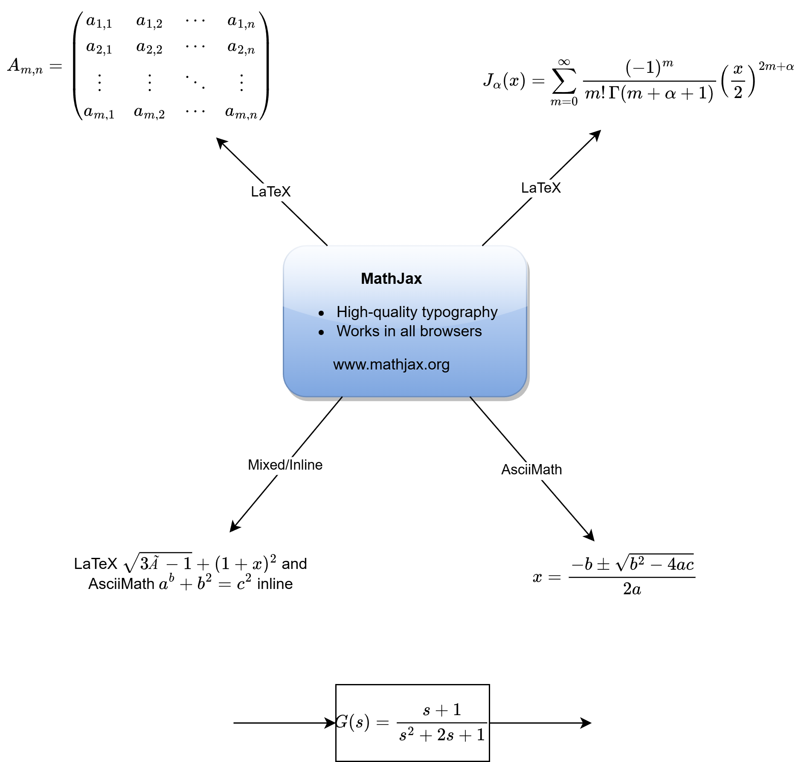

# Typst

Typst is a new markup-based typesetting system that is designed to be as powerful as LaTeX while being much easier to learn and use.[@typstgithub] 


## Install

- windows
```powershell
cd $HOME/.local
mkdir -p bin
# 1. Download the file correctly by forcing curl to follow redirects
curl.exe -L "https://github.com/typst/typst/releases/download/v0.15.1/typst-x86_64-pc-windows-msvc.zip" --output typst-x86_64-pc-windows-msvc.zip
# 2. Unzip the downloaded file into the bin folder
Expand-Archive -LiteralPath typst-x86_64-pc-windows-msvc.zip -DestinationPath bin -Force
```

## Usage

```
typst w .\main.typ
```

## Basic Writing
### Latex

$$
x^2+y^2=z^2
$$
$$
  \newcommand{\f}[2]{#1f(#2)}
  \f\relax{x} = \int_{-\infty}^\infty
    \f\hat\xi\,e^{2 \pi i \xi x}
    \,d\xi
$$

### markdown


| Column 1 | Column 2 |
| -------- | -------- |
| Row 1 Cell 1 | $x + y$  |
| Row 2 Cell 1 | $x^2 + y^2$|
- [ ] $x + y$ 
- [x] $x^2 + y^2$ 

### draw.io


## vscode extention
- `Draw.io Integration`: edit file with `.dio` suffix. set `Export Properties = 300%` in `File->Properties`.
- `Typst LSP`: typst language server(bug).
- `Tinymist Typst`: use this one for convenience.

## packages
### cmarker0.1.10
Transpile CommonMark Markdown to Typst, from within Typst.[@typstcmarker]
### plot


